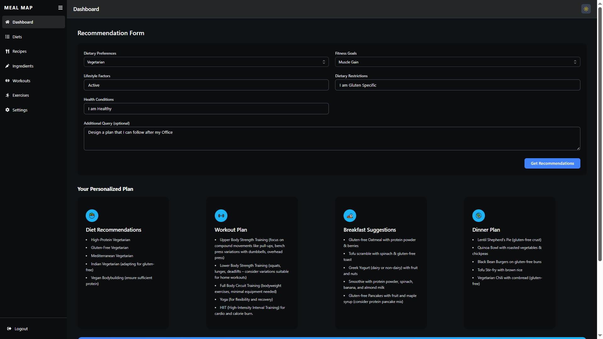
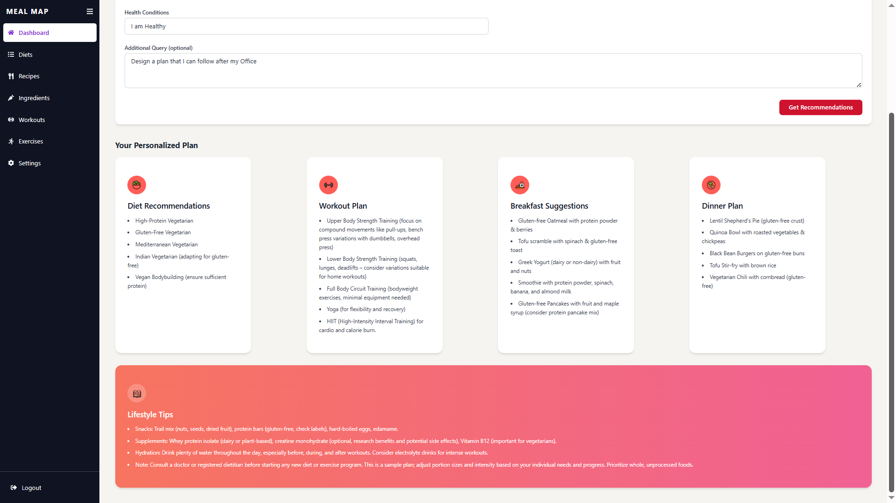

# MealMap-AI

A fullstack health dashboard that recommends personalized diet and workout plans based on custom inputs.

## Project Structure

```text
MealMap
├── backend/
│   ├── FastAPI/              # FastAPI implementation
│   │   ├── app/
│   │   │   ├── api/
│   │   │   │   └── routes/
│   │   │   ├── core/
│   │   │   ├── llm/
│   │   │   ├── schemas/
│   │   │   ├── services/
│   │   │   └── main.py
│   │   ├── .env.example
│   │   └── requirements.txt
│   │
│   └── flask/                 # Flask implementation
│
└── frontend/
    └── health-dashboard/
        ├── index.html
        ├── package.json
        ├── tailwind.config.js
        ├── vite.config.js
        ├── src/
        │   ├── App.jsx
        │   ├── main.jsx
        │   ├── index.css
        │   ├── App.css
        │   ├── assets/
        │   ├── components/
        │   ├── hooks/
        │   └── pages/
        ├── public/
        ├── eslint.config.js
        ├── postcss.config.js
        └── package-lock.json
```

<br>

<table>
  <tr>
    <td align="center" width="600">
      
      <br>
      <b>Dark Mode</b>
    </td>
    <td align="center" width="600">
      
      <br>
      <b>Light Mode</b>
    </td>
  </tr>
</table>

<br>

## Getting Started

### Backend — FastAPI

The current backend uses **FastAPI**, **Pydantic**, and **LangChain** with Google's Gemini model.

1. Navigate to the FastAPI backend:

   ```bash
   cd backend/FastAPI
   ```

2. Create and activate a virtual environment:

   ```bash
   python -m venv myvenv
   ```

   **Windows (PowerShell):**

   ```powershell
   .\myvenv\Scripts\Activate.ps1
   ```

   **macOS/Linux:**

   ```bash
   source myvenv/bin/activate
   ```

3. Install dependencies:

   ```bash
   pip install -r requirements.txt
   ```

4. Configure environment variables:

   Copy `.env.example` to a new file named `.env` and add your Google AI API key.

   ```env
   GOOGLE_API_KEY=your_google_api_key
   GEMINI_MODEL=gemini-3.5-flash-lite
   ```

   Keep your `.env` file private. Do not commit API keys to GitHub.

5. Start the FastAPI development server from inside `backend/FastAPI`:

   ```bash
   uvicorn app.main:app --reload
   ```

6. Open the API:

   - API base URL: http://127.0.0.1:8000
   - Interactive Swagger documentation: http://127.0.0.1:8000/docs
   - ReDoc documentation: http://127.0.0.1:8000/redoc


<br>

### Frontend

1. Navigate to the frontend app:

   ```bash
   cd frontend/health-dashboard
   ```

2. Install dependencies:

   ```bash
   npm install
   ```

3. Start the development server:

   ```bash
   npm run dev
   ```

4. Open in browser:

   ```text
   http://localhost:5173
   ```

## Features

* Personalized diet and workout recommendations powered by Google's Gemini model.
* Structured AI responses using LangChain and Pydantic.
* FastAPI backend with modular routing and service organization.
* Smart form handling built with React Hook Form.
* Modern, responsive dashboard built using Tailwind CSS.
* Dark mode support.
* Seamless integration between the React frontend and FastAPI backend.

## License

[MIT License](https://github.com/Yash-Bandal/MealMap-GenAI/blob/370c61b875e8bf942de685c40b9f55702d2c4842/LICENSE)

## Connect

* Author: [@Yash-Bandal](https://github.com/Yash-Bandal)

<br>

## A YB Productions original. 💝
